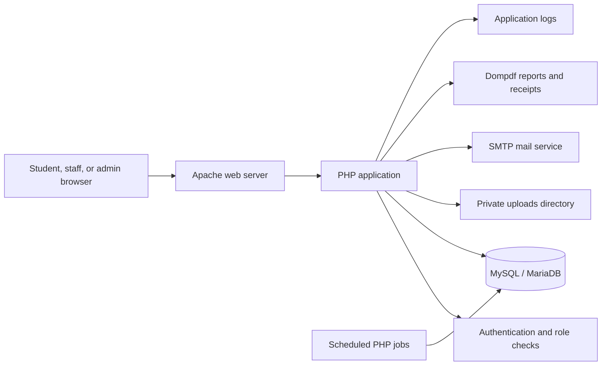
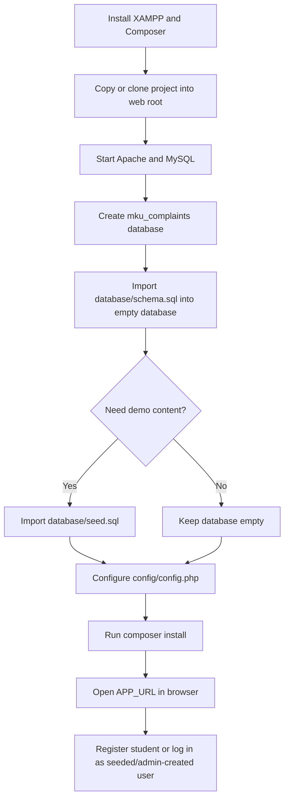
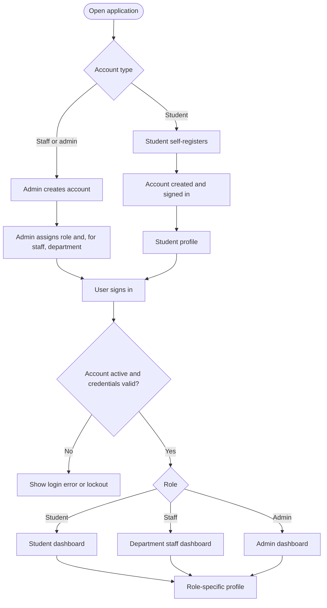
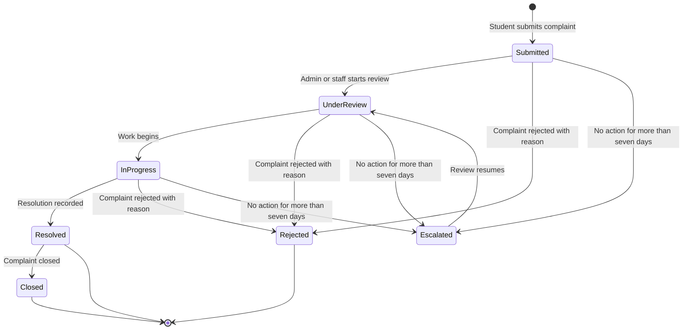
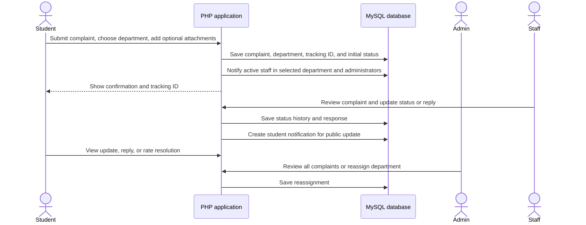
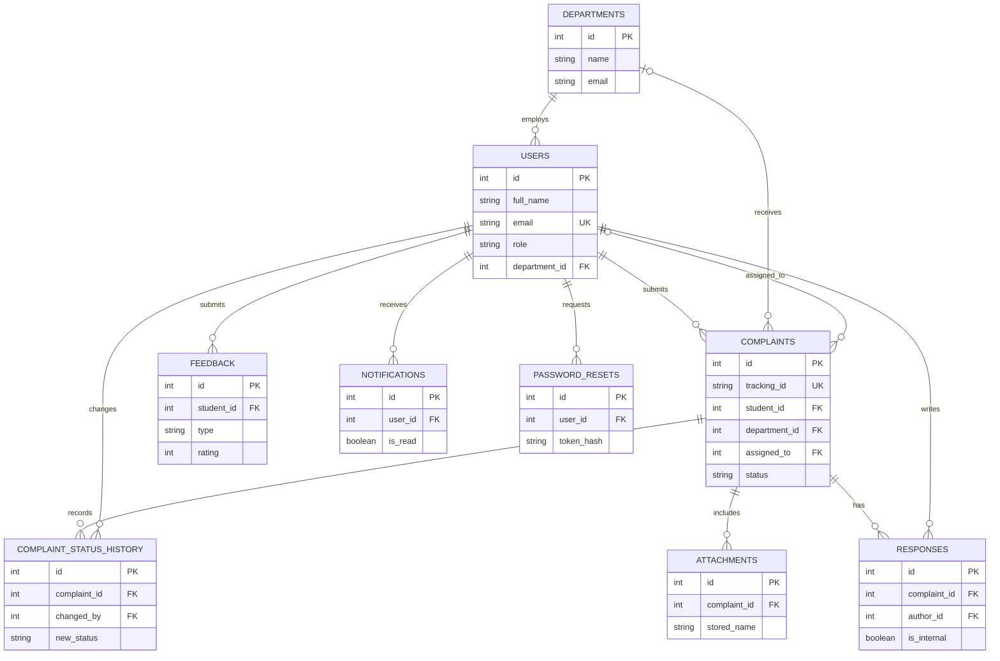

# System Diagrams

Mermaid diagrams for the application architecture, deployment, account workflows, complaint handling, and database relationships.

## Application Architecture

## Install on a New Computer

## Account and Role Workflow

## Complaint Lifecycle

## Complaint Handling Sequence

## Entity Relationships

